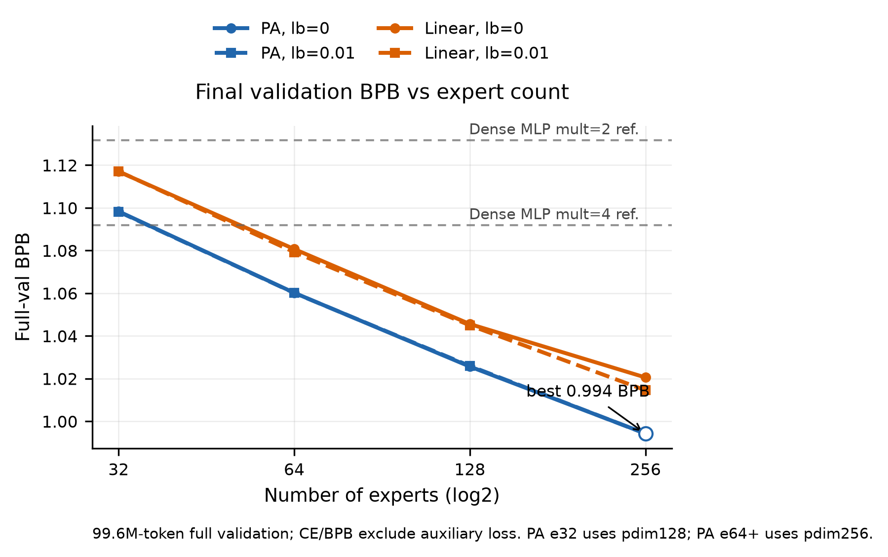
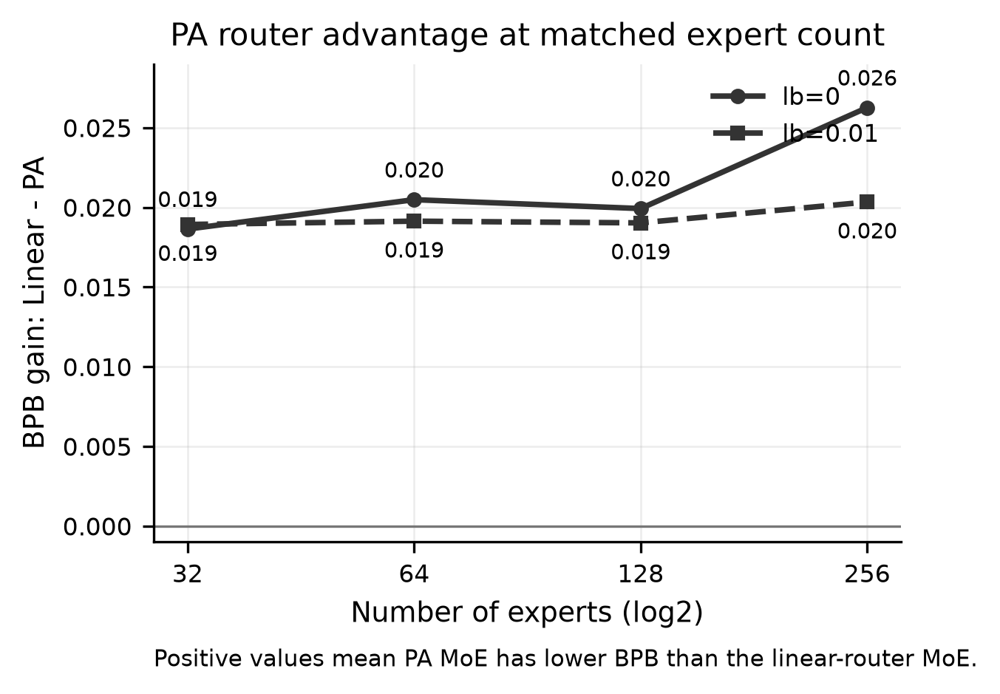
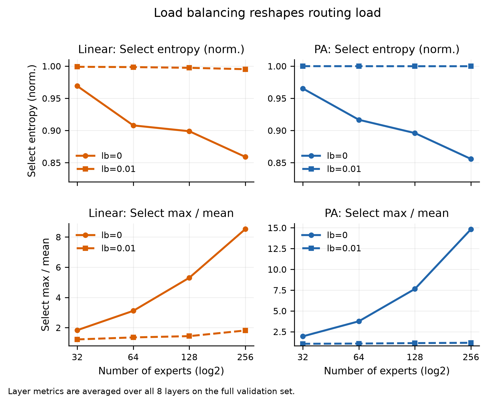
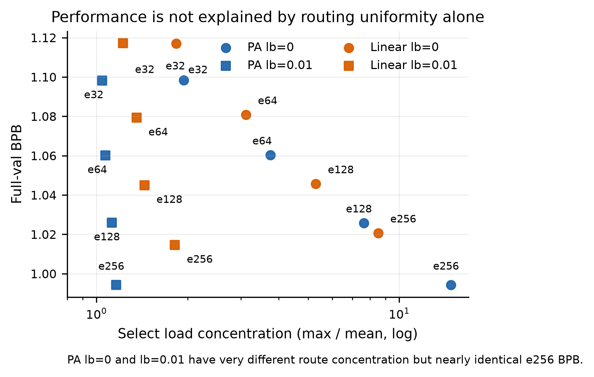
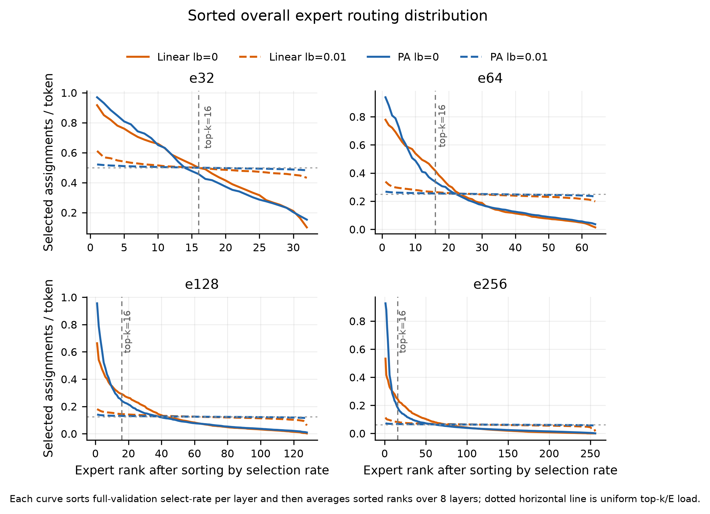
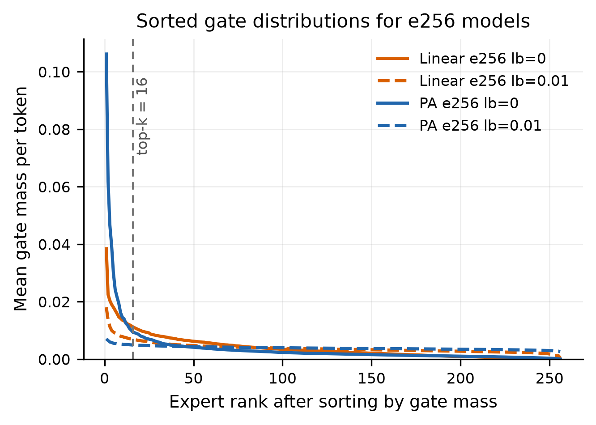

# 参数感知路由 MoE：实验阶段报告

**结果快照：** 2026-06-05 full-validation 评估  
**报告更新：** 2026-11-19  
**范围：** FineWeb-Edu 10B tokens 上的 PA router 与 Linear router 对照；这是单种子、单模型规模系列的阶段性结果，不是多种子统计结论。

## 摘要

本项目研究一种让路由器与专家参数共享表征的细粒度 MoE 路由方法。传统 router 用一个独立的线性投影为每个 expert 产生分数；PA-MoE 则从 expert 的上投影参数及其 key embedding 生成 expert key，再将 hidden state 投影为 query，以 query-key 相似度决定路由。该设计希望缓解 router 与 expert 分别学习、彼此耦合缓慢的问题。

在 8 层、512 维、每个 expert hidden dim=64、top-16 的实验中，比较了 E=32/64/128/256、Linear/PA 两种 router，以及 load-balancing auxiliary loss 系数 0/0.01。统一 full validation 为 99,617,792 tokens，评估时 auxiliary loss 系数为 0。四个专家规模和两种 LB 设置下，PA 的 BPB 均低于同配置 Linear，优势为 **0.0186–0.0263 BPB**。最佳结果是 PA E256、LB=0.01，**1.684696 CE / 0.994241 BPB**。

LB 显著改变了路由分布：选择负载熵趋近均匀，最大专家负载/均值也接近 1；但 PA 的 LB=0 与 0.01 平均 BPB 几乎相同。因此当前结果支持“PA 的优势不只是更均衡的 token 分配”，但由于每项仅有一个训练种子，仍需复现实验和更严格的因果验证。

## 1. 动机

稀疏 MoE 在 N 个专家中选择 k 个时，候选子集数量为 `C(N,k)`。路由器需要从训练信号中学会把不同 hidden state 分配给合适的专家。常见路由器用独立的 router 参数对 hidden state 做投影，而专家 MLP 参数另行更新；路由空间和专家能力之间的对应关系需要两组参数共同建立。

本项目的工作假设是：让路由 key 由专家自身参数参与构造，可以让“哪个输入适合哪个专家”的打分空间与专家当前实现的变换更直接相关，减少两套独立参数的错位。该假设是待实验检验的机制解释，并不意味着 combinatorial routing 难题已被消除。

## 2. 方法

### 2.1 PA key-query 路由

每层维护自己的专家池。对专家 `e`，训练一个 `m` 个向量组成的 key embedding；本实验 `m=4`。这些 embedding 经该 expert 的 `up_proj` 和 ReLU-squared 激活，形成 `[m, expert_dim]` 表征，再投影到 product dimension，得到该 expert 的 m 个 key。Query 路径把 hidden state 投影为 m 个 query，并归一化后与相应 key 做点积。

Query 与 key 都经过 RMSNorm。每个 query 通道各自产生对所有专家的 softmax 分布；m 个分布取平均，然后执行 **softmax → top-k → renormalize** 路由。实验 `k=16`。因此同一 token 的 16 个被选专家 gate 权重和为 1。

本轮 PA 模型中，各层的 key embedding 和 query projection 独立；同一层内 key projection 在该层全部专家间共享。`ROUTER_KEY_DETACH=1`，使 key 生成时不通过 key 路径向 expert `up_proj` 反传梯度。PA E32 使用 `product_dim=128`，E64/E128/E256 使用 `product_dim=256`。

### 2.2 对照路由与专家计算

Linear MoE 使用独立的 hidden-to-expert 线性投影得到专家 logits，再做 softmax、top-16 和权重重归一化。PA 和 Linear 共用专家计算配方：每层一个独立专家池、ReLU-squared MLP、expert hidden dim=64，不含 dense residual。训练使用 grouped expert 计算路径；本轮未启用 Expert Parallel。

### 2.3 Auxiliary load balancing

LB auxiliary loss 使用 router 概率质量与 top-k 选择频率构造 Switch-style 负载项。本实验比较训练系数 `0` 与 `0.01`。最终 full-val 的 `eval_aux_coef=0`，表中 CE/BPB 只反映语言模型交叉熵，不把 auxiliary loss 加进验证指标。

## 3. 实验设置

| 项目 | 设置 |
|---|---|
| 数据 | FineWeb-Edu `sample-10BT`，100 个训练 shards，约 10B tokenizer tokens |
| 分词器 | SentencePiece，词表 1,024 |
| 模型 | 8 层，model dim=512，GQA：8 个 Q heads / 4 个 KV heads |
| 专家 | 每层独立专家池；E=32/64/128/256，expert hidden dim=64，top-k=16 |
| MLP 激活 | ReLU-squared；无 dense residual |
| PA 路由 | m=4；E32 product dim=128，其余为 256；层内共享 key projection；key detach 开启 |
| 训练量 | 19,073 updates × 524,288 tokens/update，约 10.00B tokens；sequence length=1,024 |
| Batch / 并行 | 双卡 DDP；模型和专家参数在 rank 间复制，不是 Expert Parallel |
| 学习率日程 | 20-step warmup；warmdown=0 |
| 优化器实现 | Muon 3D batched 实现，`MUON_REDUCE_UPDATES=1`；fullgraph compile 开启 |
| 检查点 | 每个配置使用 step 19,073 checkpoint |
| Full validation | 99,617,792 tokens；全量评估并采集路由指标；eval auxiliary coefficient=0 |

主对照是 `2 router types × 4 expert counts × 2 LB coefficients = 16` 个模型。现存训练日志记录 seed=1337；本组没有多随机种子重复。训练作业分批串行完成，因此应视为同一实验方案下的 checkpoint 横评，而非随机种子统计。

## 4. 结果

### 4.1 Full-validation BPB

表中每格写作 `BPB（CE）`；“PA 优势”定义为 `Linear BPB - PA BPB`，正值表示 PA 更好。

| Experts | PA pdim | Linear 参数量 | PA 参数量 | PA 新增参数 | LB=0：PA | LB=0：Linear | PA 优势 | LB=0.01：PA | LB=0.01：Linear | PA 优势 |
|---:|---:|---:|---:|---:|---:|---:|---:|---:|---:|---:|
| 32 | 128 | 23.743M | 26.298M | +2.556M (+10.77%) | 1.098358 (1.861119) | 1.116996 (1.892700) | 0.018638 | 1.098212 (1.860871) | 1.117139 (1.892942) | 0.018926 |
| 64 | 256 | 40.651M | 45.763M | +5.112M (+12.57%) | 1.060220 (1.796495) | 1.080702 (1.831201) | 0.020482 | 1.060138 (1.796356) | 1.079272 (1.828778) | 0.019134 |
| 128 | 256 | 74.467M | 80.366M | +5.898M (+7.92%) | 1.025663 (1.737940) | 1.045588 (1.771703) | 0.019926 | 1.025956 (1.738437) | 1.044983 (1.770676) | 0.019026 |
| 256 | 256 | 142.101M | 149.572M | +7.471M (+5.26%) | 0.994298 (1.684794) | 1.020557 (1.729289) | 0.026259 | **0.994241 (1.684696)** | 1.014576 (1.719154) | 0.020335 |

在每个专家规模、每个 LB 系数的匹配对照中，PA BPB 均更低，优势约 1.7%–2.6%（相对 Linear BPB）。随着专家数从 32 增至 256，两类 router 的 BPB 均单调下降。E256、LB=0.01 是本轮最佳点。

### 4.2 参数开销与 Dense 参考

相对同专家数 Linear MoE，PA 增加约 2.56M–7.47M 参数；随专家规模增加，新增参数占比从 10.77%–12.57% 降至 5.26%。参数开销不是零，但在大 E 端占总参数比例较低。

图中的 Dense MLP mult=2 / mult=4 参考 BPB 分别约为 1.1316 / 1.0918。它们是历史 Dense 参考，不属于这 16 个同轮、同结构的 router 配对实验；因此不将其当作严格控制变量的 Dense 对照。PA E32 的 BPB 约 1.098，略高于该 Dense mult=4 参考；E64 及以上低于该参考。

### 4.3 Load balancing 与路由形态

对 8 层的 layer metrics 求平均：

| Router | LB 系数 | 归一化选择熵 | Select max / mean | 归一化 gate 熵 |
|---|---:|---:|---:|---:|
| Linear | 0 | 0.9087 | 4.694 | 0.9427 |
| Linear | 0.01 | 0.9975 | 1.458 | 0.9844 |
| PA | 0 | 0.9084 | 7.039 | 0.8942 |
| PA | 0.01 | 0.9999 | 1.100 | 0.9974 |

LB 明显提高两种路由器的选择均匀度。PA 在无 LB 时的选择集中度高于 Linear；加入 LB 后 PA 的选择负载非常接近均匀。与此同时，PA 的跨 E 平均 BPB 在 LB=0 与 LB=0.01 下分别为 1.044635 和 1.044637，几乎相同；逐 E 的差异也都小于 0.0004 BPB。Linear 的跨 E 平均值从 1.065961（LB=0）变为 1.063992（LB=0.01），改善约 0.00197 BPB。

这表明在当前模型和训练预算下，路由均衡指标与最终 BPB 并非简单单调对应；尤其 PA 在路由分布变化很大的情况下，最终 BPB 基本不变。该观察与“PA 优势不只是由更均匀负载带来”一致，但不能单独证明 PA 的机制因果性。

### 4.4 专家分布可视化

以下总体分布是对 full-validation 样本统计各层 expert selection rate；先在每层内按专家负载排序，再对 8 层的同一 rank 求均值。它显示各模型负载分布随 rank 的形状，避免把不同层的专家 ID 混在一起。Sorted gate 图展示 E256 的平均 gate mass 排序；它与 selection frequency 是不同统计量。

其余分层热图、训练曲线与 route-collection 吞吐图见 [实验图目录](../results/finewebedu_10b_20260605/figures/README.md)。吞吐图来自收集路由统计的 full-val 流程，不代表纯推理吞吐。

## 5. 当前结论

1. **配对结果支持 PA router 在本实验族中优于 Linear router。** E32–E256、LB=0/0.01 的 8 个匹配比较全部为正增益，范围 0.0186–0.0263 BPB。
2. **扩展专家数在本轮预算下带来一致的验证收益。** Linear 与 PA 的 BPB 都随 E=32→256 单调下降；E256 PA 达到 0.994241 BPB。
3. **LB 有效改变路由负载，但其收益依赖 router。** 它显著提高选择熵并降低 max/mean；PA 的最终 BPB 对 LB 系数不敏感，Linear 的平均 BPB 有小幅改善。
4. **PA 有额外参数成本。** 当前实现增加 2.56M–7.47M 参数；更大 E 时相对占比下降。
5. **“路由更均衡就一定更好”不符合当前观察。** PA 无 LB 与有 LB 的路由分布差异明显，但 BPB 几乎一致。

## 6. 限制与下一步

- 每个配置只有一个 seed；目前没有置信区间或跨 seed 方差，约 0.0001–0.001 量级的差异不宜作强结论。
- Dense 数值是历史参考，不是与本轮 16 个模型完全成对的重跑结果。
- 目前只覆盖 dim=512、8 层、expert dim=64、top-16、ReLU-squared 和 10B-token 预算；不能直接外推到更大宽度、不同激活函数或不同数据规模。
- PA E32 使用 pdim128，而 E64+ 使用 pdim256；专家规模比较同时包含 product dimension 变化，因此不应把所有 E 间差异归因于 E 本身。
- 目前 full-val 汇总主要给出最终指标和路由形态；尚未在本报告中做显著性检验、按领域分层评估或对路由 key/expert 参数做机制消融。
- DDP 每张卡持有完整专家参数，本轮实验不衡量 Expert Parallel 的通信效率或显存优势。

建议下一阶段先对 E128/E256 的 PA 与 Linear 各做至少 3 个种子复现；同时固定 pdim 进行专家数消融，并在相同预算下重跑 Dense mult=4。之后再做 key detach、m 值、key-projection sharing 和 LB 系数的正交消融，以区分参数化方式、路由均衡与训练方差的影响。

## 数据与产物

- Full-val 指标：[`full_val_summary.csv`](../results/finewebedu_10b_20260605/full_val_summary.csv)
- 分层路由指标：[`layer_route_metrics.csv`](../results/finewebedu_10b_20260605/layer_route_metrics.csv)
- 检查点映射：[`resolved_checkpoints.csv`](../results/finewebedu_10b_20260605/resolved_checkpoints.csv)
- 图表：[`figures/`](../results/finewebedu_10b_20260605/figures/)（9 张图，各含 PNG/SVG/PDF）
